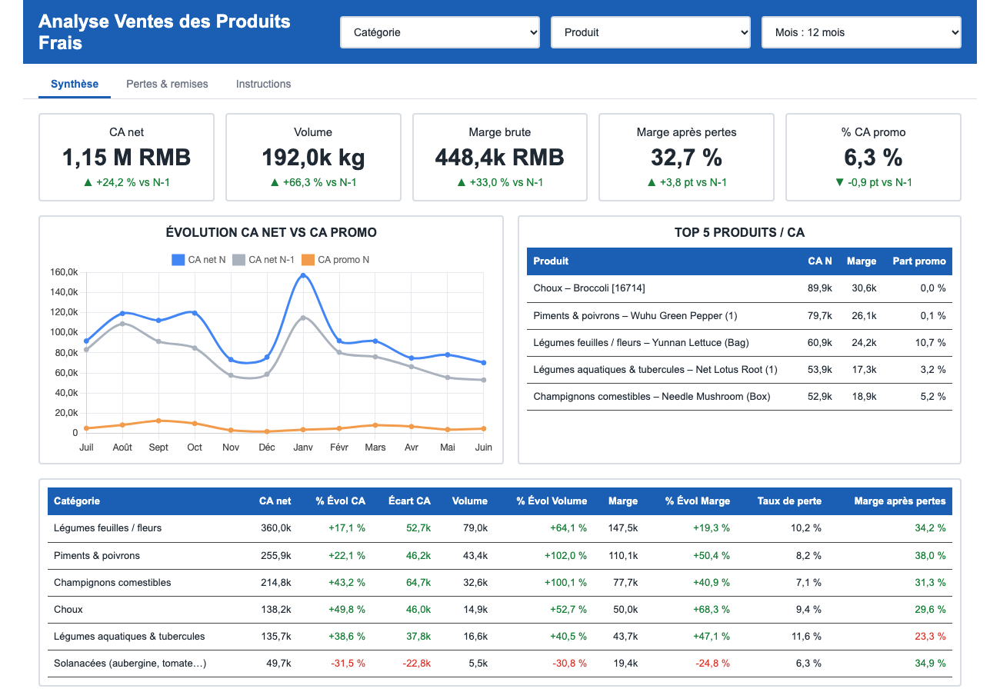
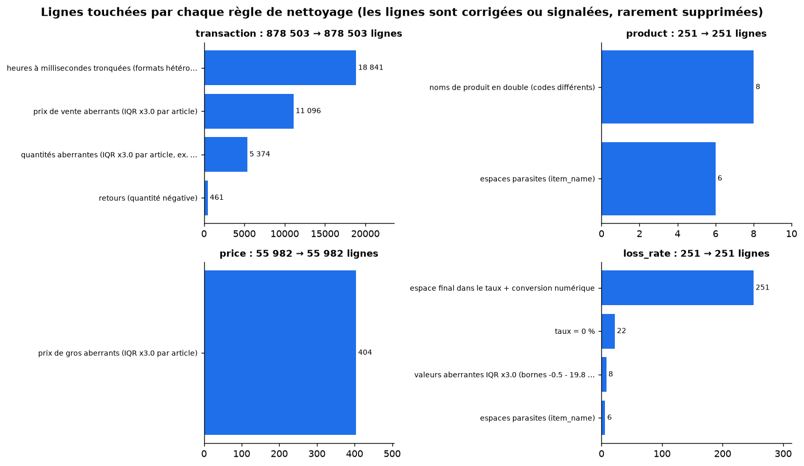
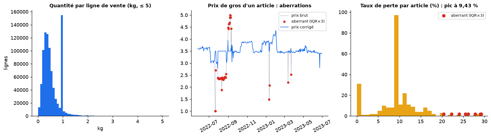
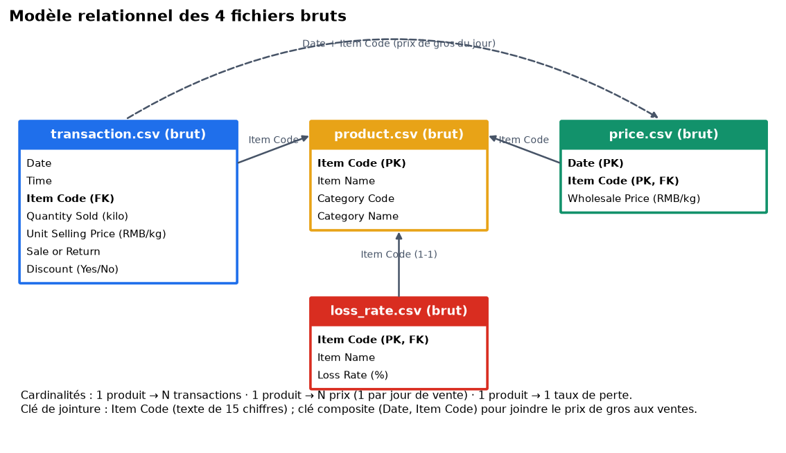
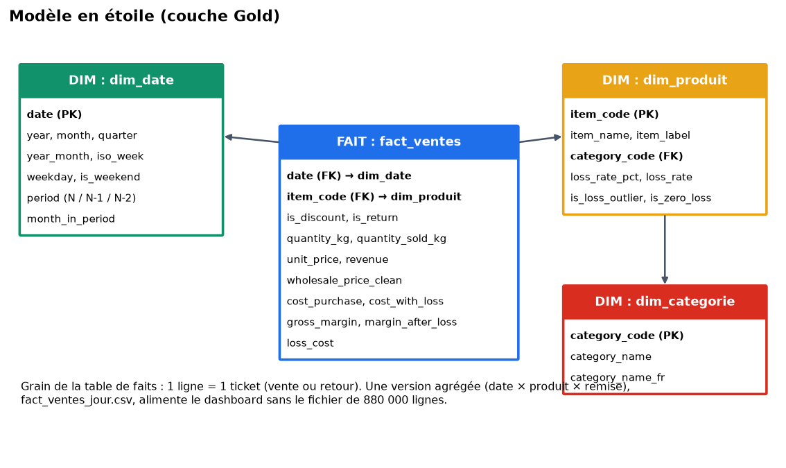

# Data Analytics : produits frais (légumes) – Binta Kande

Projet individuel Eugenia School (Data Analytics). On répond à la demande du Comex : **« nos ventes de produits frais ne performent pas assez sur certaines catégories : qu'est-ce qui bloque ? »**

Le dépôt contient les **3 exercices du cours** :

| Exercice | Livrable | Où |
|---|---|---|
| **1** – Compréhension métier | 5W, dictionnaire des données, pièges, maquette | [`docs/exercice-1-comprehension.md`](docs/exercice-1-comprehension.md) |
| **2** – Nettoyage et modélisation | Code de nettoyage (4 fichiers), modèle en étoile, stratégie Git | `src/`, ce README (étapes 1 à 3), [`docs/regles_nettoyage.md`](docs/regles_nettoyage.md) |
| **3** – DataViz / Reporting | Dashboard interactif (HTML) + présentation Comex (PDF) | [`dashboard/dashboard.html`](dashboard/dashboard.html), [`livrables/Presentation_Produits_Frais.pdf`](livrables/Presentation_Produits_Frais.pdf), [`docs/exercice-3-dataviz.md`](docs/exercice-3-dataviz.md) |



## Résultat clé

CA net **+24 %** vs N-1 (1,15 M RMB), mais : (1) les **Solanacées reculent de 31 %**, (2) les **légumes aquatiques & tubercules** ont la plus forte perte (11,6 %) et la marge après pertes la plus faible (23 %), (3) les **remises** réduisent la marge après pertes à 5 % (contre 35 %), (4) le prix moyen au kg a baissé de 25 %. Détail dans [`docs/exercice-3-dataviz.md`](docs/exercice-3-dataviz.md).

---

## Démarrage rapide

```bash
git clone https://github.com/bkande1601-collab/Data-Analytics-Binta.git
cd Data-Analytics-Binta
python3 -m venv .venv && source .venv/bin/activate
pip install -r requirements.txt

# 1. Placer le gros fichier de transactions (voir « Données » ci-dessous)
cp /chemin/vers/transaction.csv data/raw/transaction.csv

# 2. Tout exécuter (nettoyage, modèle en étoile, dashboard, figures, tests)
python -m src.run_pipeline
pytest
```

Durée : environ 15 secondes. Résultat : `data/silver/` (données propres), `data/gold/` (modèle en étoile), `dashboard/dashboard.html`, `figures/`, `docs/reports/`.

> **Sans** `transaction.csv`, on peut quand même ouvrir `dashboard/dashboard.html` et régénérer le dashboard : `python -m src.build_dashboard` (et `python -m src.build_slides` pour la présentation PDF, via Chrome) (il utilise `data/gold/fact_ventes_jour.csv`, versionné).

### Données

| Fichier | Lignes | Versionné ? | Remarque |
|---|---:|---|---|
| `data/raw/product.csv` | 251 | oui | article → catégorie |
| `data/raw/loss_rate.csv` | 251 | oui | taux de perte par article |
| `data/raw/price.csv` | 55 982 | oui (1,8 Mo) | prix de gros par jour et article |
| `data/raw/transaction.csv` | 878 503 | **non** (49 Mo, listé dans `.gitignore`) | à copier à la main dans `data/raw/` |

Les fichiers fournis étaient nommés `product (1).csv`, etc. ; il suffit de les renommer.

---

## Structure du dépôt

```
data/raw/        fichiers sources (transaction.csv non versionné)
data/silver/     données nettoyées (non versionné, régénérable)
data/gold/       modèle en étoile : dim_*.csv + fact_ventes_jour.csv (la table de faits ligne à ligne, non versionnée)
src/             code : clean_*.py (1 par fichier), build_gold.py, build_dashboard.py, run_pipeline.py
tests/           tests pytest des règles de nettoyage et des formules de marge
docs/            exercice 1, règles de nettoyage, exercice 3, rapports JSON
dashboard/       template + dashboard.html autonome
figures/         schémas et graphiques utilisés dans les docs
```

---

## Étape 1 : diagnostic et règles de nettoyage (un fichier = un « membre »)

Chaque fichier a son script, sa branche Git et ses tests. Toutes les règles sont **justifiées par la logique métier** et comptabilisées automatiquement dans [`docs/regles_nettoyage.md`](docs/regles_nettoyage.md).



| Fichier / script | Anomalies repérées | Règles appliquées |
|---|---|---|
| **transaction.csv** – `clean_transaction.py` | codes de 15 chiffres (risque de perte si traités en nombre) ; **heures de formats différents** (18 841 lignes à millisecondes tronquées) ; **461 retours** en quantité négative ; remise en `Yes/No` ; **quantités et prix extrêmes** (ex. 160 kg, 119,9 RMB/kg) | types corrigés ; `datetime` unifiée ; remise → booléen ; retours **conservés** (`is_return`, CA net) ; doublons stricts, quantité nulle, prix ≤ 0 et codes orphelins supprimés (0 trouvé) ; valeurs extrêmes **signalées** (IQR × 3 par article, ≥ 30 observations), non supprimées |
| **product.csv** – `clean_product.py` | espaces parasites dans les noms ; **8 articles à noms partagés** (« Chinese Cabbage » ×2, codes différents) ; catégories en anglais | `strip`, doublons de clé, cohérence code ↔ libellé de catégorie, `item_label` unique, `category_name_fr` |
| **price.csv** – `clean_price.py` | prix de gros **aberrants** (0,01 à 141 RMB/kg) ; un prix par jour et par article **uniquement les jours de vente** | dates typées, prix ≤ 0 et doublons (date, article) traités, 404 aberrants (IQR × 3) signalés et remplacés par la médiane de l'article dans `wholesale_price_clean` |
| **loss_rate.csv** – `clean_loss_rate.py` | **BOM** en tête de fichier ; espace final dans chaque taux (`4.39 `) ; **22 articles à 0 %**, **85 articles à 9,43 %** (valeur par défaut probable) ; 8 taux extrêmes | `utf-8-sig`, `strip` + conversion numérique, contrôle 0-100 %, flags `is_zero_loss` et `is_loss_outlier` (conservés : une forte perte est une information), imputation prévue par la médiane de catégorie si manquant |

Contrôles qualité visuels :



**Cohérence entre fichiers** (vérifiée) : les 251 codes sont identiques dans `product` et `loss_rate`, tous les codes de `price` et de `transaction` existent dans `product`, 5 articles n'ont aucune vente. Chaque vente a un prix de gros pour le même jour (couverture de 100 %).

---

## Étape 2 : modèle de données

### Modèle relationnel (bruts)



### Modèle en étoile (Gold)



- **Table de faits** `fact_ventes` : 1 ligne = 1 ticket. Mesures : CA net, quantité vendue/retournée, coût d'achat, coût avec pertes, marge brute, marge après pertes, coût des pertes. Version agrégée `fact_ventes_jour` (date × article × remise) pour le dashboard.
- **Dimensions** : `dim_date` (avec les périodes N, N-1, N-2 sur 12 mois glissants), `dim_produit` (avec taux de perte), `dim_categorie`.
- **Formules** : `marge après pertes = CA net − coût d'achat ÷ (1 − taux de perte)`. Voir le dictionnaire complet dans [`docs/exercice-1-comprehension.md`](docs/exercice-1-comprehension.md).

---

## Étape 3 : code de nettoyage et consolidation

```
src/common.py            lecture CSV (texte), rapport de nettoyage, détection IQR par article
src/clean_product.py     ┐
src/clean_loss_rate.py   │ 1 fonction clean_xxx(df) -> (df propre, rapport) + 1 main() qui écrit data/silver
src/clean_price.py       │
src/clean_transaction.py ┘
src/build_gold.py        jointures + mesures -> modèle en étoile (contrôles d'intégrité : pas de ligne perdue ni dupliquée)
src/build_dashboard.py   génère dashboard/dashboard.html
src/run_pipeline.py      enchaîne tout
```

Choix de conception : lecture **tout en texte** puis conversions explicites ; le nettoyage ne supprime que ce qui est **impossible** (prix ≤ 0, taux hors 0-100 %, doublon strict), et **signale** le reste (outliers) pour que la décision métier reste visible ; chaque règle est comptée et exportée dans `docs/reports/*.json`. Les formules de marge sont couvertes par des tests (`pytest`).

---

## Stratégie Git

Chaque fichier de données a sa **branche feature** ; elles sont fusionnées dans `develop` (intégration), puis `develop` dans `main` (production) par **pull requests** :

```
main ◄──────────────────────────────────────── (PR) develop
                                                  ▲
        feature/clean-transaction ─ PR ───────────┤
        feature/clean-product ───── PR ───────────┤
        feature/clean-price ─────── PR ───────────┤
        feature/clean-loss-rate ─── PR ───────────┤
        feature/exercice-1-5w ───── PR ───────────┤
        feature/star-schema-gold ── PR ───────────┤
        feature/dashboard ───────── PR ───────────┤
        feature/docs-readme ─────── PR ───────────┘
```

Convention des commits : un message en français décrivant le *pourquoi*.

## Exercice 3 : dashboard

Voir [`docs/exercice-3-dataviz.md`](docs/exercice-3-dataviz.md) : lecture en 3 secondes, insights chiffrés, recommandations, choix de visualisation, limites.

## Limites

- Taux de perte statique par article (pas d'historique), dont 85 identiques (9,43 %) : marge après pertes = estimation.
- Pas de stock ni de ruptures : un recul de ventes peut venir d'un manque de marchandise.
- Données d'un seul contexte (RMB), aucune conversion de devise.
