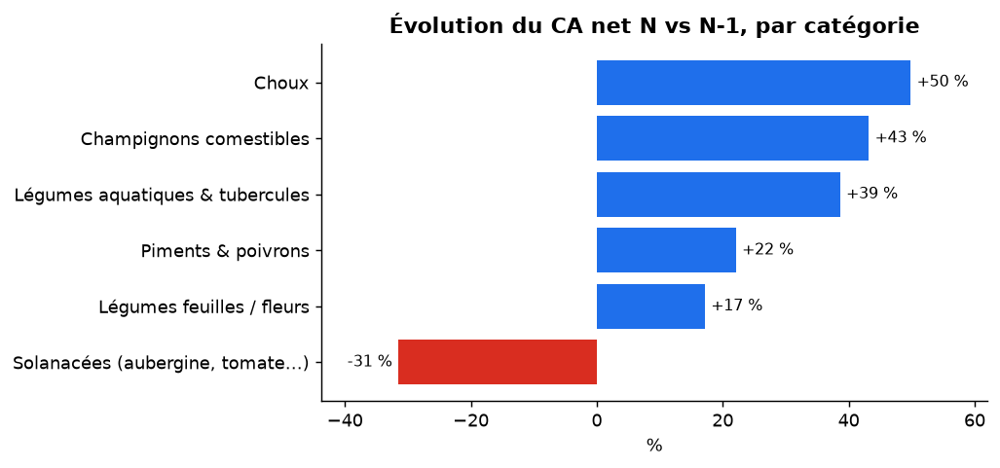

# Exercice 1 – Compréhension métier, compréhension des données, maquette

> **Contexte (message Slack du manager)** : « Le Comex trouve que nos ventes des produits frais ne performent pas assez sur certaines catégories. Il me faudrait un truc clair pour demain matin sur ce qui bloque, histoire qu'on sache où agir. »

**Reformulation de la problématique** : *sur les 12 derniers mois, dans quelles catégories de produits frais la performance (chiffre d'affaires, marge) est-elle insuffisante, et quel est le principal facteur de blocage (baisse des ventes, pertes, remises) ?*

---

## 1. Compréhension métier : les « 5W »

| W | Question | Réponse |
|---|---|---|
| **Why** (Pourquoi) | Qu'est-ce qu'on cherche à accomplir ? | Identifier **où** la performance des produits frais décroche et **pourquoi**, pour que le Comex décide d'une action ciblée (réassort, réduction des pertes, politique de remise, déréférencement). Objectif : retrouver de la croissance **rentable** sur les catégories qui reculent. |
| **Who** (Qui) | Qui est l'audience ? | **Audience finale** : le Comex / la Direction (décision en quelques secondes, pas de jargon). **Demandeur** : le manager de l'Analytics Engineer. **Parties prenantes à associer** : achats / approvisionnement (prix de gros, commandes), category managers (gamme, prix), responsables magasin (pertes, remises). |
| **What** (Quoi) | Quel livrable ? Quels KPI ? | Un **dashboard** (ou quelques slides) répondant à une question par graphique. **KPI** (slide 20 du cours) : **CA net** ; **Marge brute** ; **Volume vendu (kg)** ; **Évolution vs N-1** (%) ; **Écart vs N-1** (valeur). KPI ajoutés car la demande parle de « ce qui bloque » : **taux de perte**, **marge après pertes** et **effet des remises**. Niveau d'analyse : **catégorie** (axe demandé), puis produit pour expliquer. |
| **Where** (Où) | Où sont les données ? | 4 extractions CSV du système de caisse / achats : `transaction.csv` (≈ 878 000 lignes de tickets, 49 Mo), `product.csv` (251 articles et 6 catégories), `price.csv` (≈ 56 000 prix de gros journaliers), `loss_rate.csv` (251 taux de perte). Stockées dans `data/raw/` du dépôt (le fichier de transactions n'est pas versionné : trop volumineux). Dans une vraie entreprise : entrepôt de données (ex. `project_id.dataset_id.view_sales`). |
| **When** (Quand) | Quelle échéance, quelle période ? | **Échéance** : « demain matin » → livrable court et fiable en priorité (MVP), enrichi ensuite. **Période** : les **12 derniers mois** (juillet 2022 → juin 2023, fin des données) comparés à **N-1** (juillet 2021 → juin 2022), à périmètre identique (mêmes mois). Historique complet disponible : juillet 2020 → juin 2023. **Catégorie** : toutes (à déterminer par l'analyse). |

### Questions précises à instruire (slide 16 : « poser des questions précises »)

1. Quelles catégories ont un **CA net en baisse** vs N-1 ? Est-ce un problème de **volume** (kg) ou de **prix** (RMB/kg) ?
2. Quelles catégories ont la **marge brute** la plus faible ou en recul ?
3. Quelles catégories subissent les plus forts **taux de perte**, et combien de **marge** détruisent-ils (marge après pertes) ?
4. Les **remises** soutiennent-elles les ventes, ou dégradent-elles la marge ?
5. Les **retours** sont-ils significatifs ? Quels produits concentrent les plus gros écarts (pertes, marge négative) ?
6. La baisse est-elle **structurelle** (toute l'année) ou **saisonnière** (quelques mois) ?

---

## 2. Compréhension des données : dictionnaire des données

### 2.1 Colonnes minimales nécessaires pour répondre à la demande

| Besoin | Colonnes minimales | Fichier |
|---|---|---|
| Axe d'analyse « catégorie » | `Item Code`, `Category Name` | product |
| CA, volume, évolution vs N-1 | `Date`, `Item Code`, `Quantity Sold (kilo)`, `Unit Selling Price (RMB/kg)`, `Sale or Return` | transaction |
| Marge brute | `Wholesale Price (RMB/kg)` (coût d'achat) par `Date` + `Item Code` | price |
| Pertes / marge après pertes | `Loss Rate (%)` par `Item Code` | loss_rate |
| Effet promo | `Discount (Yes/No)` | transaction |

### 2.2 Dictionnaire des données

Format de la slide 17 : champ, type, description, formule, exemple, source.

**Données brutes**

| Champ | Type | Description | Formule | Exemple | Source |
|---|---|---|---|---|---|
| Date | Date (AAAA-MM-JJ) | Jour de la vente (transaction) ou du prix de gros (price) | NA | 2020-07-01 | transaction.csv, price.csv |
| Time | Heure texte (HH:MM:SS.mmm) | Heure du ticket, format variable (ms parfois tronquées) | NA | 09:15:07.924 | transaction.csv |
| Item Code | Texte (15 chiffres) | Identifiant article = **clé de jointure** (ne jamais le traiter comme un nombre) | NA | 102900005115168 | les 4 fichiers |
| Item Name | Texte | Nom du produit (translittération du chinois) | NA | Niushou Shengcai | product.csv, loss_rate.csv |
| Category Code | Texte (10 chiffres) | Code de la catégorie | NA | 1011010101 | product.csv |
| Category Name | Texte | Libellé de catégorie (6 valeurs) | NA | Flower/Leaf Vegetables | product.csv |
| Quantity Sold (kilo) | Numérique (kg) | Quantité vendue ; **négative pour un retour** | NA | 0.396 | transaction.csv |
| Unit Selling Price (RMB/kg) | Numérique | Prix de vente au kilo, remise déjà incluse | NA | 7.6 | transaction.csv |
| Sale or Return | Catégorie (`sale` / `return`) | Nature de la ligne | NA | sale | transaction.csv |
| Discount (Yes/No) | Catégorie (`Yes` / `No`) | La vente est-elle faite avec remise ? | NA | No | transaction.csv |
| Wholesale Price (RMB/kg) | Numérique | Prix de gros du jour = coût d'achat par kg | NA | 3.88 | price.csv |
| Loss Rate (%) | Numérique (0-100) | Part des achats perdue (casse, péremption) | NA | 4.39 | loss_rate.csv |

**Mesures calculées (couche Gold)**

| Champ | Type | Description | Formule | Exemple | Source |
|---|---|---|---|---|---|
| `revenue` (CA net) | Numérique (RMB) | CA d'une ligne, **net des retours** (un retour est négatif) | quantité × prix de vente | 0,396 × 7,6 = 3,01 | fact_ventes |
| `quantity_sold_kg` | Numérique (kg) | Volume vendu **hors retours** | quantité si `sale`, sinon 0 | 0,396 | fact_ventes |
| `cost_purchase` | Numérique (RMB) | Coût d'achat de la quantité nette | quantité nette × prix de gros du jour | 0,396 × 3,88 | fact_ventes |
| `cost_with_loss` | Numérique (RMB) | Coût d'achat incluant ce qu'on jette | `cost_purchase` ÷ (1 − taux de perte) | 36 ÷ (1 − 0,2) = 45 | fact_ventes |
| `gross_margin` (marge brute) | Numérique (RMB) | CA net − coût d'achat | `revenue` − `cost_purchase` | | fact_ventes |
| `margin_after_loss` | Numérique (RMB) | Marge réelle après perte des invendus | `revenue` − `cost_with_loss` | | fact_ventes |
| `loss_cost` | Numérique (RMB) | Valeur détruite par les pertes | `cost_with_loss` − `cost_purchase` | | fact_ventes |
| Évolution vs N-1 | % | Croissance sur 12 mois glissants | CA(N) ÷ CA(N-1) − 1 | +24 % | dashboard |
| Écart vs N-1 | RMB | Écart absolu | CA(N) − CA(N-1) | +224 552 | dashboard |
| Taux de perte pondéré | % | Perte moyenne pondérée par les achats (≠ moyenne simple des articles) | `loss_cost` ÷ `cost_with_loss` | 9,1 % | dashboard |

### 2.3 Le piège : anomalies et biais à challenger dans ces données

La principale **anomalie/biais** à anticiper est celle des **retours et remises dans le CA** : sans traitement, un retour (quantité négative) se mélange aux ventes, et les ventes remisées gonflent le volume mais dégradent la marge. Les contrôles listés ci-dessous ont tous été faits sur les données réelles (résultats dans `docs/regles_nettoyage.md`).

| Piège | Pourquoi c'est dangereux | Constat dans les données | Traitement |
|---|---|---|---|
| **Retours** (quantités négatives) | Ignorés → CA surévalué ; comptés comme des ventes → volume faussé | 461 retours (−2 257 RMB sur 3,37 M RMB) | conservés, `is_return`, CA net |
| **Clés mal typées** (code à 15 chiffres) | Converti en nombre → chiffres perdus, jointures cassées | codes en texte | typés en `string` |
| **Heures hétérogènes** | Tri et analyse horaire faux | 18 841 heures à millisecondes tronquées | format unifié |
| **Prix de gros aberrants** (0,01 ou 141 RMB/kg) | Marge fantaisiste (×1600 entre vente et achat) | 404 prix signalés (IQR × 3) | prix corrigé par la médiane de l'article |
| **Prix de gros absent certains jours** | Impossible de calculer la marge | le prix de gros n'existe que les jours où l'article est vendu : jointure sur (date, article) couvre 100 % | contrôle de couverture |
| **Taux de perte « par défaut »** | Un seul taux par article (pas de variation dans le temps) ; **85 articles sur 251 ont exactement 9,43 %** (valeur d'imputation probable) et 22 articles ont 0 % | biais : la perte réelle par produit est moins fiable que ce qu'on croit | signalé (`is_zero_loss`), limite documentée |
| **Quantités ≈ 1 kg arrondies** | 16,7 % des lignes valent exactement 1 kg (produits vendus à la pièce / au sachet) | pic à 1 kg dans la distribution | signalé, non modifié |
| **Quantités extrêmes** | 1 ligne de 160 kg | 2 % du CA | `is_qty_outlier`, conservées |
| **Période N-1 atypique** | Comparer à une année creuse flatte la croissance : N-1 est **−28 %** vs N-2 | CA N-2 = 1,29 M, N-1 = 0,93 M, N = 1,15 M | N-2 ajouté pour contexte |
| **Noms identiques / espaces parasites** | Doublons visuels dans les filtres | 4 noms avec espaces, 8 articles à nom partagé | `item_label` unique |

---

## 3. Maquette visuelle rapide : une seule image pour décider en 3 secondes

**Le graphique choisi** : barres horizontales de l'**évolution du CA net vs N-1 par catégorie**, en **rouge** quand elle est négative, en bleu sinon, triées de la plus mauvaise à la meilleure. Une KPI card au-dessus donne le CA total et son évolution. Le Directeur voit immédiatement *quelle* catégorie recule.

```
┌─────────────────────────────────────────────────────────────┐
│  CA net 12 mois : 1,15 M RMB      ▲ +24 % vs N-1            │
├─────────────────────────────────────────────────────────────┤
│  Évolution du CA par catégorie vs N-1                       │
│                                                             │
│  Solanacées               ████ -31 %          ← 🔴 À TRAITER │
│  Feuilles / fleurs              ██████████ +17 %            │
│  Piments & poivrons             ███████████ +22 %           │
│  Aquatiques & tubercules        ████████████████ +39 %      │
│  Champignons                    █████████████████ +43 %     │
│  Choux                          ███████████████████ +50 %   │
│                                                             │
│  ⚠ Mais : tubercules = marge après pertes la plus faible    │
└─────────────────────────────────────────────────────────────┘
```

Version réelle générée par le code : `figures/dataviz_evolution_ca.png`, et dans le dashboard (`dashboard/dashboard.html`).



---

### Hypothèses de travail à valider en Exercice 3

- H1 : une catégorie recule en volume (et pas seulement en prix).
- H2 : une catégorie a un taux de perte élevé qui écrase sa marge malgré un bon CA.
- H3 : les remises dégradent fortement la marge (vérifier la part du CA concernée).
- H4 : la croissance globale vient du volume, au prix d'un prix moyen au kilo plus bas.

*(Résultats : voir `docs/exercice-3-dataviz.md` et le dashboard.)*
