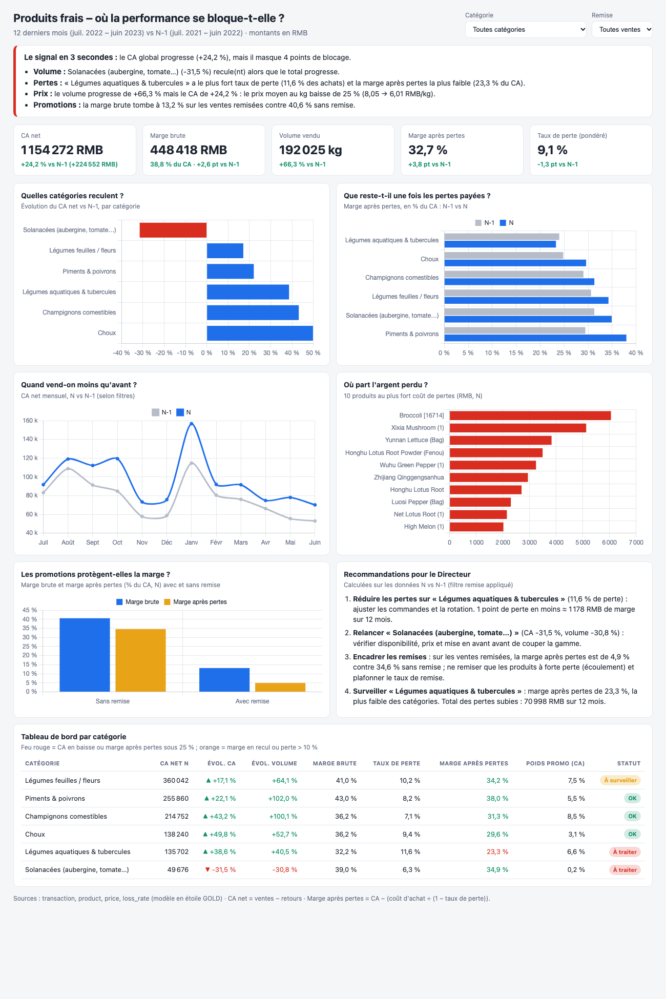

# Exercice 3 – Restitution au Comex : dashboard « Produits frais »

**Livrable** : [`dashboard/dashboard.html`](../dashboard/dashboard.html), un fichier unique et autonome (aucune connexion ni serveur : double-clic pour l'ouvrir dans un navigateur). Option choisie : **Option A – Dashboard interactif** (filtres catégorie et remise).



## Problématique (issue de l'exercice 1)

> Dans quelles catégories de produits frais la performance est-elle insuffisante, et qu'est-ce qui bloque (ventes, pertes, remises) ?

## Lecture en 3 secondes

| Question business | Graphique | Signal |
|---|---|---|
| Quelles catégories reculent ? | Barres horizontales : évolution du CA vs N-1 (rouge = baisse) | **Solanacées −31 %** (aubergines) alors que le total fait +24 % |
| Que reste-t-il après les pertes ? | Barres groupées N-1 / N : marge après pertes (% CA) | **Aquatiques & tubercules : 23 %**, la plus basse, en recul (24 % → 23 %) |
| Quand vend-on moins qu'avant ? | Courbes mensuelles N vs N-1 | N > N-1 presque tous les mois, mais forte saisonnalité (pic de janvier) |
| Où part l'argent perdu ? | Top 10 produits par coût de pertes | 10 produits = **48 %** des pertes (71 000 RMB), dont brocoli, champignon Xixia, laitue Yunnan |
| Les promos protègent-elles la marge ? | Barres : marge avec / sans remise | **Remise : marge brute 13 % vs 41 %, marge après pertes 5 % vs 35 %** pour 6 % du CA |

## Insights (chiffres 12 derniers mois, juil. 2022 → juin 2023, vs N-1)

1. **Une croissance en trompe-l'œil** : CA net **+24 %** (1,15 M RMB), mais le volume fait **+66 %** : le **prix moyen au kg a baissé de 25 %** (8,06 → 6,02 RMB/kg), surtout sur les piments (−40 %), les champignons et les feuilles (−29 %). On vend plus, moins cher. La marge brute progresse quand même (38,8 %, +2,6 pt).
2. **Un vrai recul : les Solanacées** (CA −31 %, volume −31 %). Il vient de deux articles : *Changxianqie* (19 k → 5 k RMB) et *Eggplant (2)* (43 k → 33 k RMB). La marge, elle, est bonne (35 % après pertes) : c'est un problème de **demande/disponibilité**, pas de rentabilité. Petite catégorie (49 676 RMB, 4 % du CA).
3. **Un vrai blocage de rentabilité : les légumes aquatiques & tubercules** (racine de lotus…) : CA en hausse (+39 %) mais **taux de perte 11,6 %** (le plus élevé) et **marge après pertes 23 %** (la plus basse, seule catégorie à reculer sur ce critère).
4. **Les remises détruisent la marge** : 6 % du CA seulement, mais marge après pertes de **5 %** (négative pour les choux et les aquatiques). Les remises devraient viser l'écoulement des produits à forte perte, avec un plafond.
5. **Les pertes pèsent 71 000 RMB** (6 % du CA). Elles sont concentrées : 10 produits = 48 %.
6. **Contexte** : N-1 était une année creuse (CA −28 % vs N-2). Le niveau N reste **10 % sous N-2** (1,29 M RMB) : la « croissance » est en partie un rattrapage.

## Recommandations (actionnables par le Directeur)

1. **Pertes** : plan d'action sur les 10 produits les plus perdants (ajuster les commandes, rotation, conditionnement), en commençant par les légumes aquatiques. Chaque point de perte en moins sur cette catégorie vaut environ 1 200 RMB par an.
2. **Solanacées** : diagnostiquer les ruptures et le référencement des deux aubergines en baisse avant de décider d'une action sur la gamme.
3. **Remises** : plafonner le taux de remise et les réserver aux produits à forte perte.
4. **Prix** : vérifier si la baisse du prix moyen est une politique choisie (volume) ou subie (mix, concurrence) ; suivre la marge brute par kg chaque mois.

## Choix de visualisation (règles du cours, slides 41-44, 49)

- Barres horizontales (noms de catégories/produits longs), **pas de camembert**.
- **Une question par graphique** : titre = question, sous-titre = mesure.
- **Couleurs cohérentes** : bleu = période courante, gris = N-1, **rouge = signal négatif** (le seul usage du rouge), orange = marge après pertes. Mode sombre pris en charge.
- Niveau de détail : 6 catégories en vue d'ensemble, 10 produits max, filtres pour descendre.
- Bandeau de synthèse **calculé dynamiquement** (change quand on filtre).

## Limites et précautions

- Le taux de perte est unique par article (pas de variation dans le temps) et 85 articles ont exactement 9,43 % : probablement un taux par défaut. La marge après pertes est donc une **estimation**.
- Pas de données de stock ni de surface : on ne peut pas analyser la marge par m² ni les ruptures. Un recul de ventes peut venir d'une rupture.
- Le prix de gros est celui du jour de vente (coût de remplacement), pas le coût réel d'achat du lot.
- Les données couvrent un seul point de vente / une seule monnaie (RMB) : aucun taux de change appliqué.

## Régénérer le dashboard

```bash
python -m src.build_dashboard      # à partir de data/gold/fact_ventes_jour.csv (versionné)
```
